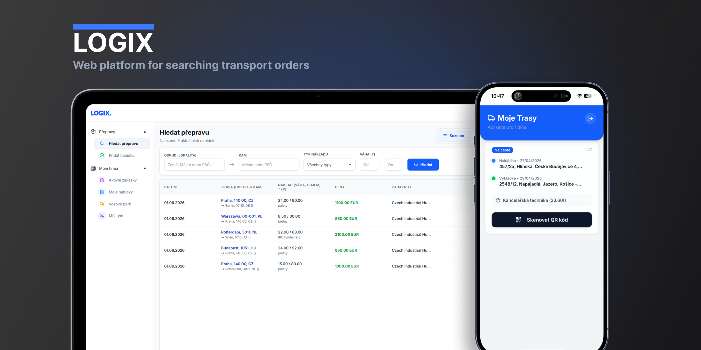
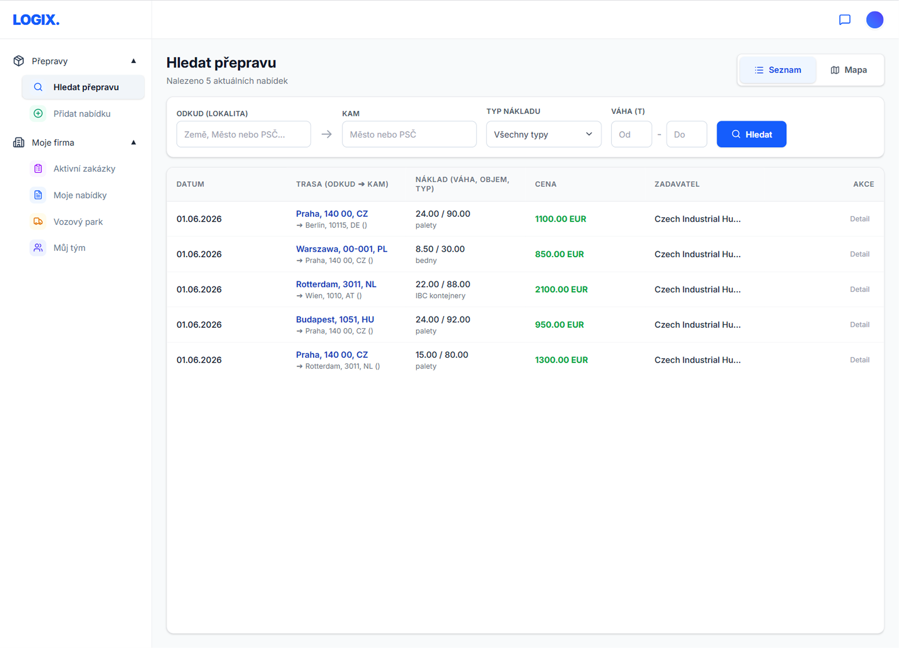
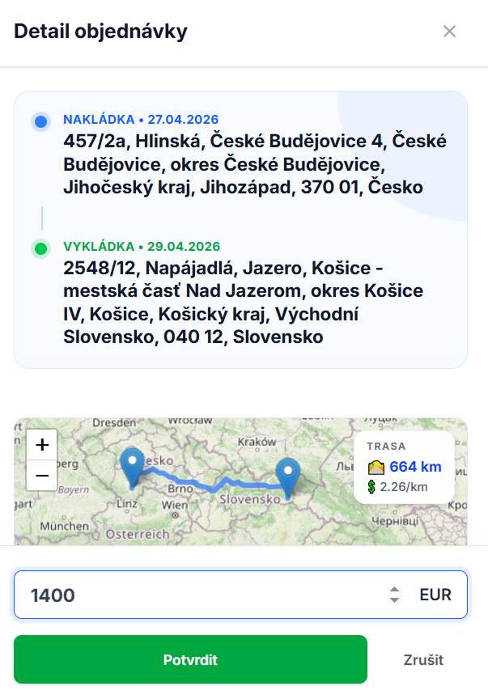
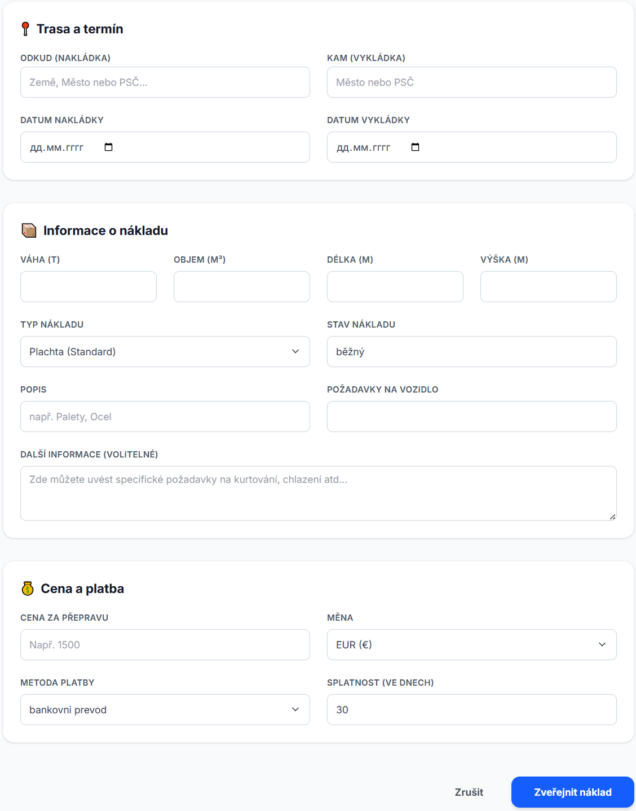
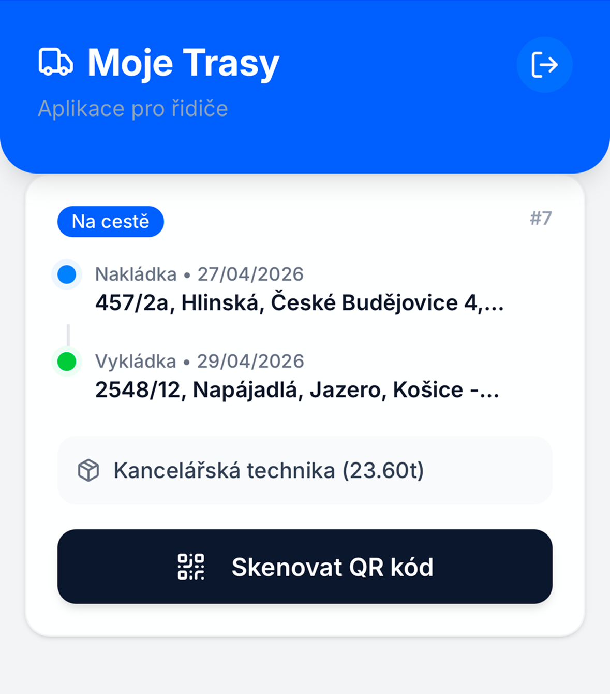
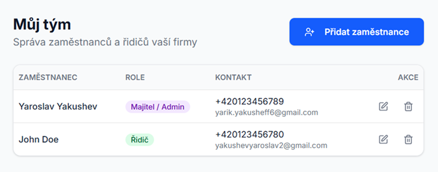
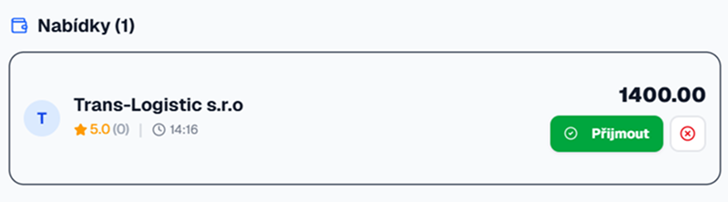
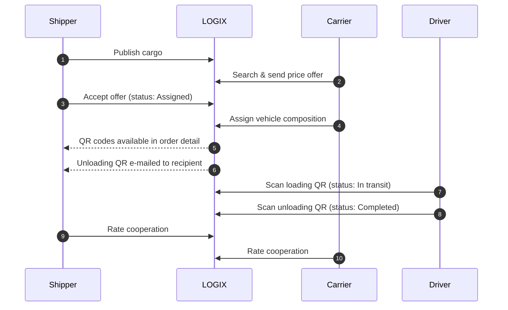
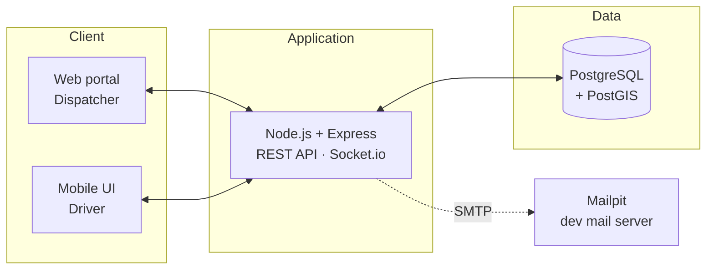

<div align="center">



# LOGIX

Connects **shippers** with **carriers** – from publishing a cargo and price offers to QR-code-verified delivery.


_Bachelor thesis · Department of Computer Science, Palacký University Olomouc · 2026_

📄 **[Read Full Thesis (PDF)](https://theses.cz/id/7tvc6r/kidiplom.pdf)**

</div>

---

## 📑 Table of Contents

- [About](#-about)
- [Key Features](#-key-features)
- [Screenshots](#-screenshots)
- [How It Works](#-how-it-works)
- [Tech Stack](#-tech-stack)
- [Architecture](#-architecture)
- [Project Structure](#-project-structure)
- [Getting Started](#-getting-started)
- [Test Accounts](#-test-accounts)
- [API Overview](#-api-overview)
- [Roadmap](#-roadmap)
- [License](#-license)
- [Author](#-author)

---

## 💡 About

Existing freight exchanges (RAALTRANS, TIMOCOM, Trans.eu) are either technologically outdated or too expensive and complex for small carriers. Most of them also ignore the driver and still depend on paper documents and phone calls.

**LOGIX** is a lightweight, modern alternative that:

- puts a **modern UI** and **real-time chat** on top of a freight exchange,
- gives **drivers their own mobile interface**,
- replaces paper confirmation with **QR-code verification** of loading and unloading,
- stays affordable and approachable for **small companies**.

| Criterion                | RAALTRANS | TIMOCOM | Trans.eu | **LOGIX** |
| ------------------------ | :-------: | :-----: | :------: | :-------: |
| Modern UI/UX             |    ❌     |   ⚠️    |    ✅    |    ✅     |
| Mobile app for drivers   |    ❌     |   ❌    |    ❌    |    ✅     |
| QR delivery verification |    ❌     |   ❌    |    ❌    |    ✅     |
| Integrated chat          |    ❌     |   ✅    |    ✅    |    ✅     |
| Suitable for small firms |    ⚠️     |   ❌    |    ⚠️    |    ✅     |

## ✨ Key Features

- 🔎 **Order search** with filters (location, cargo type, weight) in list and **map** view
- 🏢 **Company accounts** – Shipper, Carrier or Forwarder, each with its own permissions
- 👥 **User roles** inside a company – Administrator, Dispatcher, Driver
- 💶 **Price offers** – carriers bid, the shipper accepts one, the rest are rejected automatically
- 🚛 **Fleet management** – vehicles and compositions (truck + trailers, incl. Scandinavian / EuroCombi)
- 💬 **Real-time chat** bound to a specific order (Socket.io rooms)
- 📱 **Driver mobile interface** with **QR scanning** and automatic status changes
- ⭐ **Rating system** after an order is completed
- 🗺️ **Route visualization** with Leaflet + OpenStreetMap, geodata stored in PostGIS
- ✉️ **E-mail notifications** (account verification, QR codes for recipients) via Nodemailer

## 📸 Screenshots

|                               Search                                |                    Order detail                    |
| :-----------------------------------------------------------------: | :------------------------------------------------: |
|  |  |

|                              Add order                               |                             Driver mobile app                              |
| :------------------------------------------------------------------: | :------------------------------------------------------------------------: |
|  |  |

|          Team management           |                 Offers                 |
| :--------------------------------: | :------------------------------------: |
|  |  |

## 🔄 How It Works



## 🧰 Tech Stack

| Layer        | Technologies                                                        |
| ------------ | ------------------------------------------------------------------- |
| **Frontend** | React, Vite, Tailwind CSS, shadcn/ui, Axios, Leaflet, OpenStreetMap |
| **Backend**  | Node.js, Express.js, JWT, Socket.io, Nodemailer                     |
| **Database** | PostgreSQL + PostGIS                                                |
| **DevOps**   | Docker, Docker Compose, Mailpit (local SMTP testing)                |

## 🧩 Architecture

Three-tier architecture – each layer can be developed, updated and scaled independently. The client talks to the backend over a RESTful JSON API secured with **JWT**, and over **WebSocket** for chat.



## 📁 Project Structure

```
.
├── backend/                 # Node.js + Express REST API
│   ├── src/
│   │   ├── config/
│   │   ├── constants/
│   │   ├── middlewares/
│   │   ├── modules/         # auth, chat, company, composition, order, rating, user, vehicle
│   │   ├── utils/
│   │   ├── app.js
│   │   └── server.js
│   ├── .env.example
│   └── Dockerfile
├── database/
│   └── design.sql
├── frontend/                # React SPA (Vite)
│   ├── src/
│   │   ├── api/
│   │   ├── components/
│   │   ├── config/
│   │   ├── context/
│   │   ├── hooks/
│   │   ├── layouts/
│   │   ├── lib/
│   │   ├── pages/
│   │   ├── App.jsx
│   │   └── main.jsx
│   └── Dockerfile
├── docker-compose.yml
└── README.md
```

## 🚀 Getting Started

### Prerequisites

- [Docker](https://www.docker.com/) with Docker Compose

That's all – no external SMTP account is needed, e-mails are caught by a local [Mailpit](https://mailpit.axllent.org/) container.

### 1. Clone the repository

```bash
git clone https://github.com/yakuya00/A-web-based-platform-for-searching-transport-orders
cd A-web-based-platform-for-searching-transport-orders
```

### 2. Configure environment variables

```bash
cp backend/.env.example backend/.env
```

Open `backend/.env` and adjust the values if needed (database password, `JWT_SECRET`, URLs). All variables are listed in `backend/.env.example`.

> [!NOTE]
> **E-mail (Nodemailer + Mailpit).** The backend sends e-mails (account verification, QR codes for recipients) with Nodemailer. The default `.env.example` points it to the bundled Mailpit container, so no credentials are required:
>
> ```dotenv
> EMAIL_HOST=mailpit
> EMAIL_PORT=1025
> EMAIL_USER=
> EMAIL_PASSWORD=
> ```
>
> Every sent message appears in the Mailpit web UI at **http://localhost:8025**. To use a real SMTP server (e.g. Gmail with an App Password), replace these values with your own credentials.
>
> Inside Docker, `DB_HOST` is overridden to `db` by `docker-compose.yml`.

### 3. Run with Docker

```bash
docker compose up --build
```

Other useful commands:

```bash
docker compose up -d --build   # run in the background
docker compose down            # stop the application
docker compose down -v         # stop and remove the database volume (full reset)
```

On the first start, PostgreSQL automatically creates the schema from `database/design.sql`.

| Service    | URL / Port             | Description                             |
| ---------- | ---------------------- | --------------------------------------- |
| Frontend   | https://localhost:5173 | React application                       |
| Backend    | http://localhost:5000  | REST API + Socket.io                    |
| Mailpit UI | http://localhost:8025  | Inbox with all e-mails sent by the app  |
| PostgreSQL | `localhost:5433`       | PostGIS database (`5432` inside Docker) |

## 🔑 Test Accounts

All test accounts use the password **`Password123@`**

| E-mail                   | Name            | Role       | Company ID |
| ------------------------ | --------------- | ---------- | :--------: |
| `dopravce@logix.cz`      | Jan Novák       | Admin      |     1      |
| `manager1@logix.cz`      | Alena Konečná   | Dispatcher |     1      |
| `driver1@logix.cz`       | Jiří Dvořák     | Driver     |     1      |
| `driver4@logix.cz`       | Pavel Beneš     | Driver     |     1      |
| `driver5@logix.cz`       | Filip Fiala     | Driver     |     1      |
| `odesilatel@logix.cz`    | Petr Svoboda    | Admin      |     2      |
| `obchod@hub.cz`          | Markéta Němcová | Dispatcher |     2      |
| `spediter@logix.cz`      | Michal Černý    | Admin      |     3      |
| `dispecer@forwarding.cz` | Jakub Krejčí    | Dispatcher |     3      |
| `driver2@forwarding.cz`  | Tomáš Marek     | Driver     |     3      |
| `driver2@logix.cz`       | Martin Kučera   | Driver     |     3      |
| `driver3@logix.cz`       | Lukáš Pospíšil  | Driver     |     3      |

> [!IMPORTANT]
> The accounts are inserted with `is_verified = false`. To verify an account, open the verification e-mail in the **Mailpit UI** (http://localhost:8025) and click the link, or set `is_verified = true` directly in the database.

## 📡 API Overview

All protected endpoints require a JWT; data is exchanged as JSON.

<details>
<summary><b>Auth</b></summary>

| Method | Endpoint                  | Description                                |
| ------ | ------------------------- | ------------------------------------------ |
| `POST` | `/auth/full-registration` | Register a user together with company data |
| `POST` | `/auth/register`          | Basic user registration                    |
| `POST` | `/auth/login`             | Authenticate and receive a JWT             |
| `POST` | `/auth/logout`            | End the session                            |
| `GET`  | `/auth/refresh-token`     | Refresh the access token                   |
| `GET`  | `/auth/verify-email`      | Confirm e-mail via verification link       |

</details>

<details>
<summary><b>Orders</b></summary>

| Method | Endpoint                    | Description                             |
| ------ | --------------------------- | --------------------------------------- |
| `POST` | `/order`                    | Create a new order                      |
| `POST` | `/order/:id/offer`          | Submit a price offer                    |
| `POST` | `/order/:id/accept`         | Accept an offer                         |
| `POST` | `/order/:id/assign-vehicle` | Assign a vehicle composition            |
| `POST` | `/order/:id/scan-qr`        | Validate a QR code at loading/unloading |
| `GET`  | `/order/search`             | Search available orders by filters      |
| `GET`  | `/order/:id`                | Order detail                            |

</details>

<details>
<summary><b>Fleet</b></summary>

| Method   | Endpoint                         | Description            |
| -------- | -------------------------------- | ---------------------- |
| `POST`   | `/vehicle`                       | Add a vehicle          |
| `GET`    | `/vehicle`                       | List company vehicles  |
| `GET`    | `/vehicle/:id`                   | Vehicle detail         |
| `DELETE` | `/vehicle/:id`                   | Remove a vehicle       |
| `POST`   | `/vehicle-composition`           | Create a composition   |
| `GET`    | `/vehicle-composition`           | List compositions      |
| `GET`    | `/vehicle-composition/available` | List free compositions |
| `GET`    | `/vehicle-composition/:id`       | Composition detail     |
| `DELETE` | `/vehicle-composition/:id`       | Remove a composition   |

</details>

## 🎯 Roadmap

- [ ] Payment gateway with escrow payments (e.g. Stripe) released after QR-confirmed delivery
- [ ] Real-time GPS vehicle tracking
- [ ] Integration with accounting systems
- [ ] Automatic generation of CMR documents and invoices
- [ ] Multimodal transport (air, sea, rail)

## 📄 License

<a href="LICENSE" alt="LICENSE"></a>

## 👨‍💻 Author

**Yaroslav Yakushev**

Bachelor thesis supervised by Mgr. Jiří Balun, Ph.D.

Department of Computer Science, Faculty of Science, Palacký University Olomouc, 2026

[](https://github.com/yakuya00)
[](https://linkedin.com/in/yaroslav-yakushev-6759a937a)
